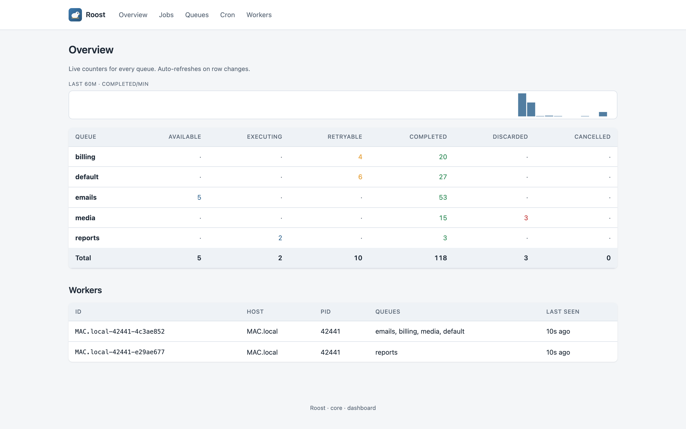
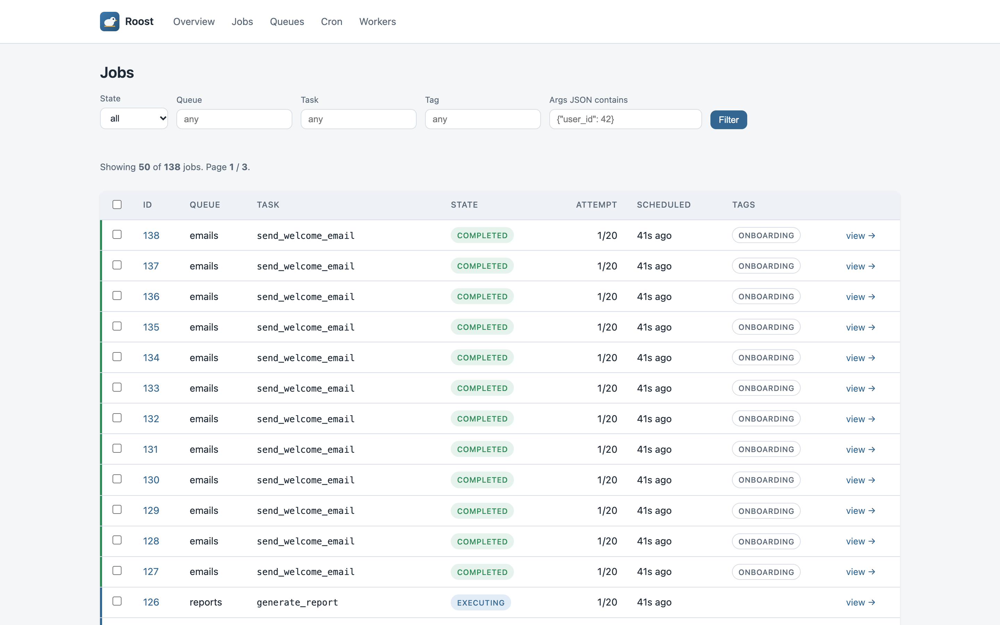
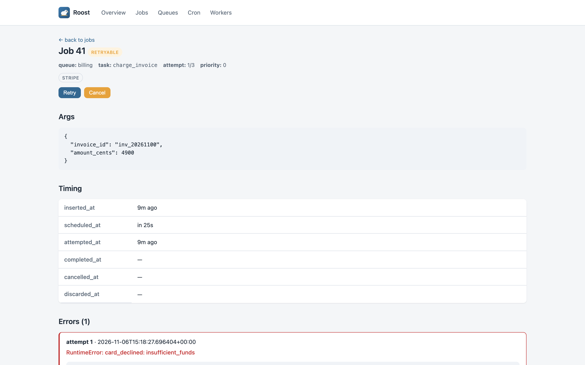
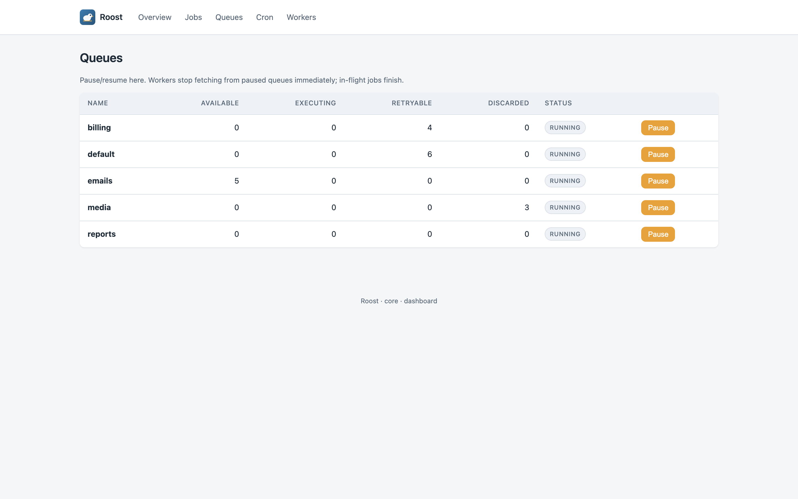

<!-- markdownlint-disable MD033 MD041 -->
<p align="center">
  
</p>

<h1 align="center">roost-web</h1>

<p align="center">
  <em>Drop-in dashboard for <a href="https://github.com/ashhadahsan/roost">Roost</a>, the Postgres-backed background job queue.</em>
</p>

<p align="center">
  <a href="https://pypi.org/project/roost-web/"></a>
  <a href="https://pypi.org/project/roost-web/"></a>
  <a href="https://github.com/ashhadahsan/roost-web/actions/workflows/ci.yml"></a>
  <a href="https://github.com/ashhadahsan/roost-web/blob/main/LICENSE"></a>
</p>

> 🚧 **Alpha**: under active development. Pin exactly.



## Install

```bash
pip install roost-web        # pulls in pgroost, the Roost core
```

## Mount it

```python
from fastapi import FastAPI
from roost_web import dashboard

app = FastAPI()
app.mount("/jobs", dashboard(dsn="postgresql://..."))
```

Three lines, no separate deploy, no Node.js. It runs inside your app, so it sits behind your app's auth.

## Screens

| Jobs | Job detail |
|---|---|
|  |  |
| **Queues** | |
|  | |

## Features

| | |
|---|---|
| Drop-in mount | `app.mount("/jobs", dashboard(dsn=...))` |
| Live updates | Server-Sent Events backed by Postgres `LISTEN`/`NOTIFY` |
| Pages | Overview · Jobs (filter by state, queue, task, tag or args JSON; bulk retry and cancel) · Job detail · Queues (pause and resume) · Cron · Workers and worker detail |
| Read-only mode | `dashboard(dsn=..., read_only=True)` returns 403 for every action |
| JSON API | `GET /api/v1/jobs`, `POST /api/v1/jobs/{id}/retry`, and so on |
| Auth | Delegated to the host app: wire your own middleware |
| Bundle | HTMX + hand-written CSS, about 60 KB, no Node toolchain |

## Why HTMX, not React?

This is an *embedded* admin dashboard for a Python queue. Its users are developers and on-call engineers. The property that matters is "pip install, mount, done". A React or Next.js dashboard would make every Python shop deploy a separate SPA and API and configure CORS. Oban Web (LiveView) and Django Admin make the same trade-off.

For a custom UI, build against the JSON API at `/api/v1`.

## Compatibility

- **Python:** 3.10 to 3.14.
- **PostgreSQL:** 13 to 18.
- **Roost:** `pgroost` 0.1.x (`>=0.1.1,<0.2`).
- **Hosts:** any ASGI app: FastAPI, Starlette, Django (via ASGI mount), Litestar, Quart.

## Mounting examples

### FastAPI

```python
from fastapi import FastAPI
from roost_web import dashboard

app = FastAPI()
app.mount("/jobs", dashboard(dsn="postgresql://..."))
```

### Starlette

```python
from starlette.applications import Starlette
from starlette.routing import Mount
from roost_web import dashboard

app = Starlette(routes=[Mount("/jobs", app=dashboard(dsn="..."))])
```

### Behind auth

See [`examples/auth_fastapi.py`](https://github.com/ashhadahsan/roost-web/blob/main/examples/auth_fastapi.py) and [`examples/auth_starlette_basic.py`](https://github.com/ashhadahsan/roost-web/blob/main/examples/auth_starlette_basic.py).

### Standalone

```bash
uvicorn examples.standalone:app --port 8000
```

## Project structure

| Concern | File |
|---|---|
| Public factory | `src/roost_web/__init__.py` |
| Starlette app | `src/roost_web/app.py` |
| HTMX routes | `src/roost_web/routes/*.py` |
| JSON API v1 | `src/roost_web/api/v1.py` |
| SSE bridge | `src/roost_web/routes/sse.py` |
| Templates | `src/roost_web/templates/` |
| Static assets (HTMX, CSS, logo) | `src/roost_web/static/` |

## Contributing

See [CONTRIBUTING.md](https://github.com/ashhadahsan/roost-web/blob/main/CONTRIBUTING.md). Security: [SECURITY.md](https://github.com/ashhadahsan/roost-web/blob/main/SECURITY.md). All participants are expected to follow the [Code of Conduct](https://github.com/ashhadahsan/roost-web/blob/main/CODE_OF_CONDUCT.md).

## License

MIT, see [LICENSE](https://github.com/ashhadahsan/roost-web/blob/main/LICENSE).
